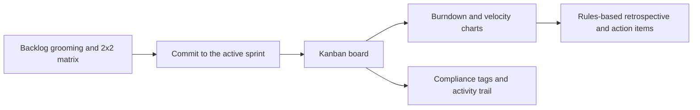

# Scrum Sprint & Retrospective Workspace (SprintForge)

**A browser-based Scrum workspace covering backlog prioritization, commitment to the active sprint, a Kanban board, burndown and velocity analytics, rules-based retrospectives, and regulatory story tagging for finance teams.**

[](LICENSE)


*The GitHub repository was previously named `sprintforge`. The npm package name and the Cloudflare Worker name in `wrangler.jsonc` are still `sprintforge`.*

---

## The problem

Small teams practicing Scrum often juggle a spreadsheet backlog, a separate board, hand-drawn burndown charts, and retrospectives whose action items are forgotten by the next sprint. Teams in regulated domains (for example fintech) also need to show which stories touched controls such as SOX, PCI-DSS, GDPR, or KYC/AML.

## Who it is for

Scrum Masters, product owners, and small delivery teams, especially ones learning Scrum or working in finance-adjacent environments, who want the whole sprint loop in one lightweight tool.

## Approach

The app runs the Scrum loop in one page: **backlog grooming → commit to the active sprint → Kanban execution → burndown and velocity analytics → retrospective → action items**.

- **Prioritize by value density** (business value ÷ effort) and a 2×2 matrix (Quick Wins, Big Bets, Fill-ins, Money Pits).
- **Make retrospectives stick:** a deterministic rules engine groups notes into nine themes (scope creep, communication, dependencies, testing, estimation, tooling, process, compliance, and workload), flags themes that already appeared in a saved retro, and proposes owned action items.
- **Capture compliance context as a by-product** of normal sprint work through story tags and a local activity trail.

## Features

### Backlog grooming and prioritization
- Fibonacci story points (1, 2, 3, 5, 8, 13), epics, assignees, and value/effort scores (1–5), ranked by value density.
- 2×2 prioritization matrix. High value is 3 or above; high effort is 3 or above.
- One-click commitment of a groomed story onto the active sprint (`→ Sprint` on the list).

### Kanban sprint board
- Drag and drop across To Do → In Progress → Review → Done.
- Today's burndown remaining point updates when a card moves to or from Done. Moves among the other columns do not change the chart.
- Double-click a card to edit title, description, epic, assignee, points, value, effort, and compliance tag (plus an optional control reference). There is no blocker field.

### Burndown, velocity, and forecasting
- Ideal vs. actual burndown. The ideal line is a straight drop from the sprint's stored committed points to zero. Actual points for past days come from saved snapshots; today is committed points minus points in Done.
- Velocity across completed sprints (committed vs. completed) with a 3-sprint rolling average.
- Deterministic forecast of sprints needed to clear uncommitted backlog points at that rolling velocity (`src/lib/forecast.js`).

### Rules-based retrospectives
- Lists positive notes under *What went well*.
- Groups negative and neutral notes into the nine themes above, shown under *Needs improvement*.
- Marks a theme that already appears in a saved retro as `↻ recurring`, and raises that theme's action item to P0.
- Generates up to four action items with owners and priorities.

The retrospective engine is [deterministic JavaScript](src/lib/retroEngine.js), **not** a language-model service. The screen is labeled "AI Retrospective" in the app; the running code does not call a model.

### Regulatory tagging and activity trail
- Tag stories with `SOX`, `KYC/AML`, `PCI-DSS`, or `GDPR`.
- Browser-local log of story creation, edits, status changes, sprint commits, and deletes, each with a timestamp.
- CSV export of the activity trail (the rows currently shown, including any framework filter).

## Workflow



## First-run walkthrough

1. Add a story with points, value, and effort.
2. Commit it from the backlog list and drag it across the board. Move it to Done if you want today's burndown point to change.
3. Open burndown and velocity. Velocity shows completed sprints already stored in the browser (seeded on first load). Open Compliance to see the new story's activity-trail entries.
4. Add retrospective observations and review the generated actions.

## Quick start

```bash
git clone https://github.com/MadanMohan0537/scrum-sprint-retro-workspace.git
cd scrum-sprint-retro-workspace
npm install
npm run dev
```

Open [http://localhost:5173](http://localhost:5173).

### Build and deploy

```bash
npm run build      # production bundle in dist/
npm run preview    # inspect the build locally
npm run deploy:workers   # Cloudflare Workers static assets (Worker name: sprintforge)
npm run deploy:pages     # or Cloudflare Pages
```

Review the configuration for your chosen Cloudflare target before deploying. `wrangler.jsonc` publishes the Worker as `sprintforge`.

## Tech stack

React 18, Tailwind CSS, Vite 5, Recharts, React Context with a reducer that appends activity-trail entries on story changes. Deployable to Cloudflare Pages or Workers static assets.

## Limitations

- All state is stored in the browser under the `localStorage` key `sprintforge-state-v1`. There are no accounts, sharing, or server persistence. If storage is unavailable, the session stays in memory.
- There is no control to create, start, or close a sprint. The velocity chart and forecast use completed sprints already in that saved state.
- Committing a story puts it on the board. It does not change the active sprint's stored committed-point total, which the burndown uses as its starting scope.
- The activity trail is editable by anyone with access to the browser storage. It is **not** a tamper-proof compliance ledger and does not demonstrate regulatory compliance. New entries are attributed to a fixed demo user.
- Retrospective categorization is keyword and sentiment rules and can misclassify feedback.
- No automated tests or CI yet, and no usage data from real teams.

## How I would evaluate it with a real team (not yet done)

- Share of retrospective action items completed by the next sprint.
- Forecast accuracy: predicted vs. actual sprints to finish a scoped backlog.
- Whether recurring issues decline after escalation.

## License

MIT. See [LICENSE](LICENSE).
