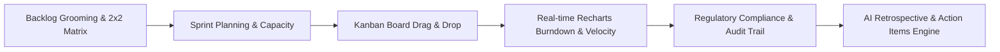

# ⚡ SprintForge — Agile Sprint & Retrospective Platform

<p align="center">
  <strong>Full-lifecycle Scrum workspace featuring real-time burndown analytics, AI-assisted retrospectives, and FinTech compliance tracking.</strong>
</p>

<p align="center">
  <a href="https://portfolio.madanmohanlearning.workers.dev/"></a>
  <a href="#license"></a>
  <a href="https://react.dev"></a>
  <a href="https://vitejs.dev"></a>
  <a href="https://recharts.org"></a>
  <a href="https://pages.cloudflare.com"></a>
</p>

---

## 📌 Overview

**SprintForge** is a modern, single-page Agile management application that runs the complete Scrum delivery loop — **backlog grooming $\rightarrow$ sprint planning $\rightarrow$ live Kanban execution $\rightarrow$ burndown & velocity analytics $\rightarrow$ AI-assisted retrospectives**.

Engineered specifically with regulated enterprise environments in mind, SprintForge includes built-in **FinTech & Regulatory Compliance Story Tagging** (`SOX`, `GDPR`, `PCI-DSS`, `KYC/AML`, `Audit-Required`) and an **immutable append-only audit trail**, ensuring engineering teams capture audit evidence as a natural byproduct of sprint execution.

---

## ✨ Key Features

### 1. 📋 Backlog Grooming & 2×2 Prioritization
- **Story Pointing & Value Density:** Assign Fibonacci story points, epics, assignees, and business value/effort scores (1–5). Automatically ranks stories by *Value Density (Value ÷ Effort)*.
- **Interactive 2×2 Prioritization Matrix:** Visual trade-off mapping across *Quick Wins*, *Big Bets*, *Fill-ins*, and *Money Pits*.
- **One-Click Sprint Commitment:** Seamlessly commit groomed backlog items directly into the active sprint.

### 2. 🗂️ Interactive Kanban Sprint Board
- Drag-and-drop workflow across **To Do $\rightarrow$ In Progress $\rightarrow$ Review $\rightarrow$ Done**.
- Real-time burndown point recalculation and state synchronization upon card transition.
- In-place modal editing for story scope, story points, blockers, and compliance controls.

### 3. 📈 Burndown, Velocity & Forecasting Analytics
- **Live Burndown Chart:** Real-time ideal vs. actual remaining story points.
- **Velocity Chart:** Multi-sprint historical comparison (committed vs. completed points) with a 3-sprint rolling average.
- **Sprint Forecasting:** Deterministic forecast projecting the number of sprints required to deliver remaining backlog scope.

### 4. 🤖 AI-Powered Sprint Retrospective Engine
- **Automated Observation Parsing:** Ingests unstructured retro feedback and categorizes sentiment into *What Went Well* vs. *What Needs Improvement*.
- **Failure Mode Clustering:** Clusters blockers across 9 Agile failure modes (Scope Creep, Dependencies, Testing Gaps, Estimation, etc.).
- **Recurrence Escalation:** Flags issues recurring across multiple sprints as `↻ recurring` and escalates them to P0.
- **Action Item Synthesis:** AI generates actionable mitigation steps with clear ownership and priority.

### 5. 🏦 FinTech & Regulatory Compliance Tracking
- **Regulatory Tagging:** Flag stories with regulatory controls: `SOX`, `KYC/AML`, `PCI-DSS`, `GDPR`.
- **Append-Only Audit Trail:** Immutable log recording all story creation, edits, status transitions, and descoping with timestamp and actor context.
- **Audit-Readiness Export:** One-click CSV export of audit trails formatted for compliance officers.

---

## 🏗️ Architecture & Data Flow



---

## 🚀 Quick Start

### Installation

```bash
# Clone the repository
git clone https://github.com/MadanMohan0537/sprintforge.git
cd sprintforge

# Install dependencies
npm install

# Start development server
npm run dev
```

Open [http://localhost:5173](http://localhost:5173) in your browser.

### Production Build & Deployment

```bash
# Build production bundle to /dist
npm run build

# Deploy to Cloudflare Pages
npm run deploy:pages
```

---

## 🛠️ Tech Stack

- **Frontend:** React 18, TailwindCSS
- **Build Tool:** Vite 5
- **Charts & Visualization:** Recharts
- **State Management:** React Context + Custom Reducer with Immutable Audit Middleware
- **Deployment:** Cloudflare Pages & Workers Static Assets

---

## 📄 License

MIT License — see [LICENSE](LICENSE) for details.
